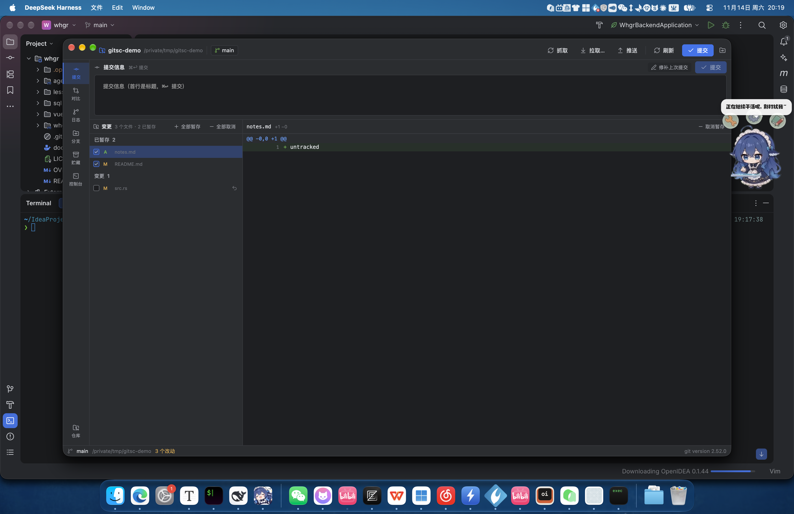
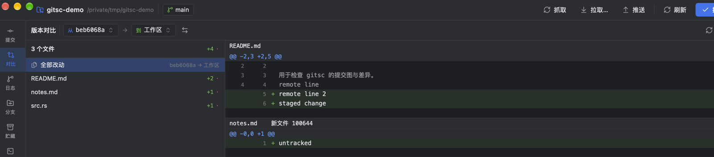
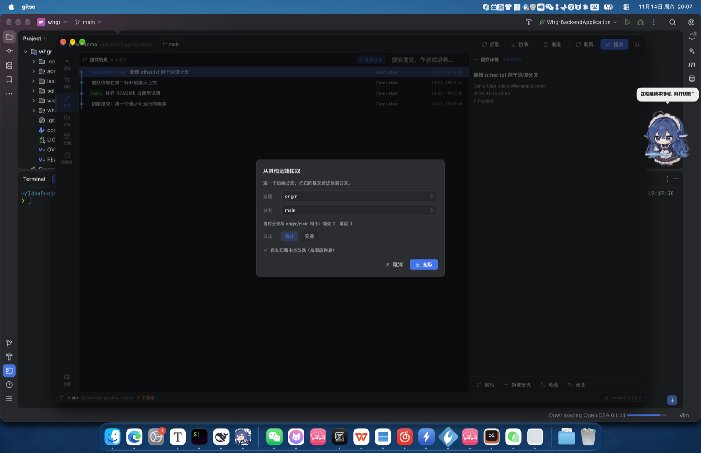

# gitsc

<p align="center">
  
</p>

一个参考 IntelliJ IDEA 的 Git 操作台，Rust + [gpui-kit](https://crates.io/crates/gpui-kit) 实现。

<p>
  <a href="https://github.com/tuean/gitsc/releases/latest"></a>
  <a href="https://github.com/tuean/gitsc/actions/workflows/build.yml"></a>
  
</p>

## 下载

到 [Releases](https://github.com/tuean/gitsc/releases) 下载：

| 平台 | 文件 | 说明 |
| --- | --- | --- |
| Windows 10/11 x64 | `gitsc-<version>-windows-x64-setup.exe` | 安装包：装到 `Program Files`，带开始菜单/桌面快捷方式与卸载项 |
| Windows 10/11 x64 | `gitsc-windows-x86_64.exe` | 免安装单文件，双击即用 |
| macOS 11+ | `gitsc-macos-<arch>.zip` | 解压得到 `gitsc.app`（Apple Silicon / Intel 按 runner 架构出包） |

运行前提：PATH 里能找到 `git`（Windows 装 [Git for Windows](https://git-scm.com/download/win)，macOS 用 Xcode Command Line Tools 自带的）。

```
顶栏   仓库名 · 分支 · 抓取/拉取/推送/提交/刷新
左栏   提交 / 对比 / 日志 / 分支 / 贮藏 / 控制台
主区   提交信息 + 变更列表 + diff ／ 任意两个版本的 diff ／ 提交图 + 提交详情 ／ 分支与标签 ／ 贮藏 ／ 命令日志
底栏   当前分支 · 进行中的任务 · 提示 · git 版本
```

## 截图

| 提交 + 差异 | 版本对比 | 从远端拉取 |
| --- | --- | --- |
|  |  |  |

## 核心用法

**对比任意两个版本**（`⌘D`）：头部「从 / 到」各点一下，可以选工作区、HEAD、本地分支、远端分支、标签，或历史里的任意提交；点中间的互换箭头对调两端，右侧是选中文件（或全部改动）的 unified diff。「从」默认是 HEAD 的父提交，「到」默认是工作区。

**从任意远端拉取到当前分支**（`⌘T`）：对话框里选远端与分支，应用会算出当前分支相对它的领先/落后数（按上次抓取），选合并或变基，可勾选「自动贮藏本地改动」——先 stash，拉完再恢复；恢复时有冲突会明确提示，并把冲突文件留在变更列表里等你解决。检出分支遇到「local changes would be overwritten」时也会自动贮藏后重试（对话框里的勾选会被记住）。

**其他**：变更勾选即 stage/unstage；提交支持 ⌘↩ 与修补上次提交；分支、标签、提交、贮藏都有右键菜单；所有 git 命令与输出都在「控制台」页可查。

## 为什么包一层 git CLI

后端没有用 `git2`，每个操作都是 `git` 子进程：

- 复用用户已经配好的凭据助手、`~/.gitconfig`、hooks、SSH agent，push/pull 不需要在应用里再配一遍认证；
- 每条命令的 argv、stdout/stderr、退出码、耗时都进「控制台」页，出问题可以把命令原样粘到终端复现；
- IDE 的 Git 集成本质上也是这么做的，行为一致性最好。

`GIT_TERMINAL_PROMPT=0` 防止凭据缺失时把 UI 挂住，`GIT_OPTIONAL_LOCKS=0` 避免和同时开着的终端抢 `index.lock`。

## 结构

```
crates/
  gitsc-core/   数据层：命令执行、porcelain v2 解析、log 解析、泳道布局、unified diff
  gitsc-app/    GPUI 界面：状态机、worker、六个面板
```

- `gitsc-core/src/command.rs` 子进程 + 转录；`status.rs` / `log.rs` / `graph.rs` / `diff.rs` / `tags.rs` / `ops.rs` / `settings.rs` 各自负责一块。
- `gitsc-app/src/worker.rs` 单线程串行执行：读操作与写操作都排队，避免两条 git 命令同时改索引。
- UI 线程只处理状态与渲染，结果通过 flume 回传。

## 交互

| 快捷键 | 动作 |
| --- | --- |
| `⌘O` | 打开仓库 |
| `⌘R` | 刷新 |
| `⌘T` | 从远端拉取（选远端/分支/方式） |
| `⌘D` | 版本对比 |
| `⌘⇧K` | 推送 |
| `⌘⇧F` | 抓取 |
| `⌘↩` | 提交 |
| `⌘N` | 新建分支 |
| `⌘1`…`⌘6` | 切换页签 |
| `Esc` | 关闭浮层 |

右键分支 / 提交 / 变更 / 贮藏 / 标签都有上下文菜单。变更列表的勾选框直接 stage/unstage，未暂存行右侧的撤销按钮丢弃改动（有确认）。

## 开发

```bash
cargo run -p gitsc-app            # 直接打开上次的仓库
cargo run -p gitsc-app -- ~/code/some-repo
cargo test -p gitsc-core          # 数据层单测（22 个）

./scripts/bundle-macos.sh        # 打成 target/gitsc.app
open -n target/gitsc.app --args ~/code/some-repo
```

设置与最近仓库落在 `~/Library/Application Support/gitsc/settings.json`（`dirs::config_dir()/gitsc`），日志同目录 `gitsc.log`。

## Windows

Windows 版与 macOS 共用同一份代码，平台差异都在 `cfg` 里：

- 标题栏：macOS 给左上角红绿灯留 78px；Windows 自绘「最小化 / 最大化 / 关闭」三个按钮（自绘标题栏才能和深色主题一致）；
- 等宽字体：macOS `Menlo`、Windows `Consolas`、Linux `DejaVu Sans Mono`；
- `git` 子进程在 Windows 上带 `CREATE_NO_WINDOW`，不会每次执行命令闪一个黑色控制台；
- 配置与日志仍在 `dirs::config_dir()/gitsc`（Windows 上是 `%APPDATA%\gitsc`）。

在 Windows 上构建（需要 [Git for Windows](https://git-scm.com/download/win) 和 rustup stable）：

```powershell
# 用 windows profile：release 优化 + 运行期编译 HLSL，
# 不需要装 Visual Studio / Windows SDK。
cargo build --profile windows -p gitsc-app
.\target\windows\gitsc.exe            # 命令行传仓库路径也可以：gitsc.exe D:\code\repo
```

Windows 版用 `debug-assertions` 打开的运行期着色器编译（不依赖 Windows SDK 的 fxc.exe），因此只需要系统自带的 `d3dcompiler_47.dll`（Windows 10/11 都有）。

在 macOS 上交叉编译并打安装包：

```bash
brew install mingw-w64 nsis
rustup target add x86_64-pc-windows-gnu
./scripts/package-windows.sh
# 产物：
#   dist/gitsc-windows-x86_64.exe                 免安装单文件
#   dist/gitsc-<version>-windows-x64-setup.exe    NSIS 安装包
```

安装包用 `installer/gitsc.nsi` 描述（NSIS 3）：默认装到 `$PROGRAMFILES64\gitsc`，写开始菜单与桌面快捷方式，注册「应用和功能」里的卸载项；卸载时不删 `%APPDATA%\gitsc` 里的配置和最近仓库。CI（`.github/workflows/build.yml`）在 `windows-latest` 上用 MSVC 构建 exe + 安装包，打 `v*` tag 时自动挂到 Release。

运行需要 Windows 10 1809+ / Windows 11 与 [Git for Windows](https://git-scm.com/download/win)（`git.exe` 在 PATH 里）。

## Logo

标记是一条 git 提交图：蓝色主干、紫色旁支，绿色节点是当前提交（HEAD）。配色取自 IDE 主题的 lane 色板。

- 源文件：`design/logo.svg`（矢量）、`design/logo-1024.png` 及 512/256/128/64/32/16 各尺寸；
- 应用内标记：`design/mark-256.png`（透明底，欢迎页标题旁使用，源码里 `include_bytes!` 嵌入）；
- 应用图标：`design/gitsc.icns`（macOS，`scripts/bundle-macos.sh` 会打进 .app）、`design/gitsc.ico`（Windows，构建时通过 `crates/gitsc-app/build.rs` + `gitsc.rc` 嵌进 exe）；
- 重新生成：`python3 scripts/make-logo.py`（需要 Pillow；macOS 上会顺带调 `iconutil`）。
